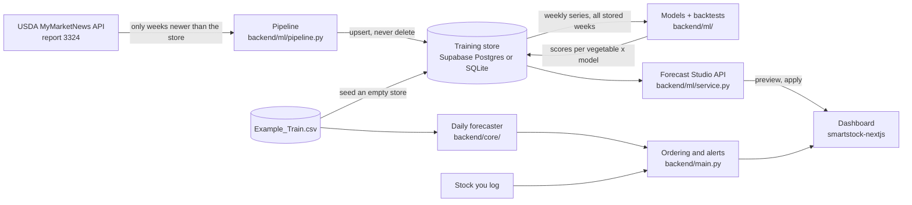

# SmartStock AI

Produce price forecasting and smart ordering for restaurants. SmartStock learns weekly USDA retail prices for eleven vegetables, forecasts where each price is heading, and tells a kitchen how much to order and when, based on what's in the walk-in, how fast it's used, and how long it keeps.

**Live demo:** https://smartstock-ai-d6v1.onrender.com (free plan, so the first visit after a quiet spell takes about a minute to wake)

[](https://github.com/atanwar8/Smart-Stock-AI/actions/workflows/ci.yml)
[](https://render.com/deploy?repo=https://github.com/atanwar8/Smart-Stock-AI)

## What it does

| Page | What you get |
| --- | --- |
| **Overview** | Price pulse for any vegetable (USDA history, then the forecast with a likely range), days of cover for every tracked item, what needs ordering, each model's forecast skill, and growing weather for any US ZIP code. |
| **Smart ordering** | Log stock and daily use; get a recommended order quantity and cost, plus the cheapest day to buy over the next week. |
| **Forecast studio** | Pick a model (Ensemble, LightGBM, ETS, Theta, seasonal naive, TimesFM where available), shape a sample prediction with sliders (horizon, confidence, history, a pace what-if), see how it did on held-out weeks, and **Apply** it. The applied forecast is saved and shown across the app. |
| **Alerts** | Running-out, spoilage and price-move alerts, each explained in one sentence against your own rule, with Silence 24h / Not relevant and J/K keys. |
| **Data refresh** | The Extract → Load → Train → Test pipeline: pulls only the USDA weeks newer than the store, appends them, and rescores every model. Shows the store's coverage and every past run. |

The design is a "chef's market almanac": porcelain canvas, produce drawn as small animated symbols, hand-made SVG charts, keyboard shortcuts (1–5 switch sections, J/K move between produce).

## How it works



- **Training store** (`backend/store/`): four tables, `usda_prices`, `ingest_runs`, `training_runs`, `forecasts` ([ADR-006](docs/decisions/ADR-006-training-store-and-forecast-studio.md)). Supabase Postgres when `SUPABASE_DB_URL` is set, otherwise `backend/var/smartstock.db`. An empty store is seeded once with the last two years of `Example_Train.csv` (6,783 rows, 2023-07-28 to 2025-07-25).
- **Pipeline** (`backend/ml/pipeline.py`, `POST /api/pipeline/refresh`): Extract asks USDA only for the newest stored week (again, for corrections) through today; Load upserts on the natural key, so re-runs add nothing and nothing is deleted; Train and Test backtest every model on all stored weeks with the newest 8 held out, and store the scores. Without a key the run is recorded as skipped and models are still rescored. One refresh at a time across processes (Postgres advisory lock).
- **Forecast Studio** (`backend/ml/service.py`, `backend/routers/forecast.py`): `/forecast/models`, `/forecast/leaderboard`, `/forecast/preview`, `/forecast/apply`, `/forecast/active` (contract in [`docs/handoff/SPEC.md`](docs/handoff/SPEC.md) §5). Previews are cached per data version, so moving the horizon, confidence or pace slider is instant.
The overview and ordering pages still use the original daily forecaster on the CSV:

- **Data agent** (`backend/core/usda_api.py`) asks USDA's MyMarketNews API for every weekly National Retail Report (report 3324) since the newest week in `Example_Train.csv`, maps the rows to the training columns, and appends them. It re-requests the newest stored week, so corrections USDA publishes replace the old rows. It runs every time the server starts, because a fresh container only has the CSV from the repo ([ADR-004](docs/decisions/ADR-004-refresh-usda-data-on-startup.md)).
- **Forecast agent** (`backend/core/forecaster_utils.py`) turns each vegetable's rows into one weekly price series in its usual unit (per lb, each, per bunch...). It trains a LightGBM model on past weeks only, then forecasts week by week from the latest real price.
- **Ordering and alerts agent** (`backend/main.py`) combines the stock you log, each item's shelf life and the forecasts into order recommendations and running-out, spoilage and price-move alerts.

### How good are the forecasts?

Forecast Studio's models are scored on the newest 8 weeks they never saw; [`docs/ml/MODEL_GUIDE.md`](docs/ml/MODEL_GUIDE.md) explains each model and reports the measured results. Short version: weekly retail prices are close to a random walk, LightGBM is best on average but only about 4% better than "same week last year", and "same as last week" still wins 4 of 11 vegetables.

The daily forecaster on the overview is scored with time-series cross-validation against a simple rule: "next week costs the same as this week". The dashboard shows the result as **typical error** (in dollars) and **forecast skill** (how much smaller the model's error is than that rule's). Weekly retail prices are noisy, so expect modest skill, not "95% accuracy". [ADR-002](docs/decisions/ADR-002-weekly-series-forecasting.md) explains why the original 95% figure was an artifact.

## Run it

| Where | Command | Open |
| --- | --- | --- |
| Cloud | Click **Deploy to Render** above | the URL Render gives you |
| Docker | `docker compose up --build` | http://localhost:8000 |
| Local dev (hot reload) | `./start.sh` | http://localhost:3000 |
| Local, like production | `./start.sh prod` | http://localhost:8000 |

`./start.sh` needs Python 3.9+ (production and CI use 3.11) and Node 20+. The first run installs everything into `backend/.venv` and `smartstock-nextjs/node_modules`. On macOS, LightGBM and XGBoost need `brew install libomp`; without it the backend falls back to scikit-learn models.

In production the dashboard and the API share one origin: the UI calls `/api/...`, and FastAPI answers the same routes with or without the `/api` prefix. In dev, Next.js proxies `/api` to `localhost:8000`. Interactive API docs are at `/docs`.

## Deploying

`render.yaml` defines one Docker web service on Render's free plan. Every push to `main` runs CI on GitHub. Services created from the blueprint (the button above) deploy only after every check passes (`autoDeployTrigger: checksPass`). For a service created another way, set **Settings → Build & Deploy → Auto-Deploy** to **After CI Checks Pass** in the Render dashboard to get the same behavior.

[ADR-001](docs/decisions/ADR-001-single-container-on-render.md) explains why this ships as one container on Render.

## Configuration

Copy `backend/.env.template` to `backend/.env` for local runs, or set these in the Render dashboard.

| Variable | Default | What it does |
| --- | --- | --- |
| `MARS_API_KEY` | none | Free USDA MyMarketNews API key ([sign up](https://mymarketnews.ams.usda.gov), then My Profile, API Key). **Data refresh** needs it. |
| `SUPABASE_DB_URL` | none (local SQLite) | Postgres URL of the training store. Use Supabase's **session pooler** string (`postgresql://postgres.<ref>:<password>@aws-1-us-west-2.pooler.supabase.com:5432/postgres`): Render has no IPv6, so the direct `db.<ref>.supabase.co` host fails there. |
| `SMARTSTOCK_DB_PATH` | `backend/var/smartstock.db` | SQLite file used when `SUPABASE_DB_URL` is unset. |
| `PIPELINE_ON_STARTUP` | `1` | At startup: seed an empty store, close runs a crash left open, and score the models once if the store has never been scored (background thread). |
| `PIPELINE_TRAIN_ON_STARTUP` | `1` | Set `0` to skip that first scoring (the leaderboard then computes per vegetable on first view). |
| `TEST_WEEKS` | `8` | Weeks held out for the leaderboard. |
| `SERIES_REGION` | `Midwest` | USDA region the models use (every region is stored). |
| `ENABLE_TIMESFM` | `0` | `1` runs TimesFM in the server (needs `timesfm` + `torch` and ~1 GB RAM). Otherwise the studio serves a stored offline run, or shows TimesFM as unavailable. |
| `REFRESH_ON_STARTUP` | `1` | With a key set, pull new USDA weeks every time the server starts, then train the models. |
| `SEED_DEMO_INVENTORY` | `1` | Starts with four tracked items so the dashboard isn't empty. Set `0` to start blank. |
| `PRETRAIN_MODELS` | `1` | Trains every vegetable's model in the background at startup. |
| `ALLOWED_ORIGINS` | `http://localhost:3000` | Extra CORS origins, only if the UI is hosted separately. |
| `DATA_DIR` | repo root | Folder that holds the CSVs. |
| `PORT` | `8000` | Port the server listens on (Render sets this). |

## Tests and quality checks

```bash
cd backend && .venv/bin/pip install -r requirements-dev.txt && .venv/bin/python -m pytest
```

```bash
cd smartstock-nextjs && npm run lint && npx tsc --noEmit && npm run build
```

GitHub Actions (`.github/workflows/ci.yml`) runs all of this on every push and pull request, plus `npm audit` and a Docker build. Dependabot opens one pull request per outdated dependency each week, and CI checks each one.

The backend tests (75) also cover the training store (seed once, upserts that update corrections and never delete, one applied forecast per vegetable), the pipeline (window starts at the newest stored week, re-runs add nothing, missing key and rejected key are recorded, one refresh at a time), the models (no look-ahead, shared LightGBM gives the same answer, conformal bands widen with confidence and horizon) and the studio API (preview shape, sliders, Sample prediction → Apply → supersede, contract error codes). Tests always run on a temporary SQLite file, never Supabase. Earlier suites cover the data agent (request format, field mapping, paging, appending without duplicates), the forecast agent (one point per week in one unit, no look-ahead, honest scores on unpredictable prices, forecasts that start from the latest price) and the API (both URL prefixes, predictions, the trend chart, inventory, alert rules, units).

## Project layout

```
smartstock-nextjs/     Dashboard: Next.js static export, Tailwind v4, hand-made SVG charts, lucide icons
  src/components/      One file per page; shell/ (rail, top bar), overview/, ordering/, studio/ (Forecast Studio),
                       charts/ (SVG chart kit), produce/ProduceIcon.tsx (animated produce symbols), ui.tsx (UI kit)
  src/lib/             API clients (api.ts, studio.ts, pipeline.ts), types, navigation, hooks
backend/
  main.py              API routes, inventory, alerts, caching headers, serves the built dashboard
  routers/forecast.py  /forecast/* and /pipeline/* routes
  ml/                  Models, rolling-origin backtests, conformal intervals, studio service, refresh pipeline
  store/               Training store (Supabase Postgres or SQLite), seeding
  scripts/             offline_timesfm.py (score TimesFM on a bigger machine and store the results)
  core/usda_api.py     Data agent (USDA MyMarketNews API client)
  core/open_meteo.py   Weather by ZIP code from Open-Meteo (no key needed)
  core/                Forecast agent (weekly series, features, training, prediction)
  tests/               pytest suite
Example_Train.csv      Weekly USDA retail prices, 2010 to the latest scrape
docs/decisions/        Architecture decision records
docs/ml/               MODEL_GUIDE.md: the models, the maths, measured results, model card
docs/handoff/          SPEC.md (API + design contract) and each workstream's handoff note
supabase/migrations/   The training store's schema
Dockerfile             Builds the dashboard, then runs API + dashboard in one image
render.yaml            Render blueprint
start.sh               One-command local run
```

## Known limits

- Inventory and alert settings live in memory, so they reset on restart or redeploy. USDA prices, model scores and applied forecasts persist in the training store when `SUPABASE_DB_URL` is set (on Render without it, the SQLite store is on temporary disk and is rebuilt from the CSV on each start).
- TimesFM can't run on the free Render plan (512 MB); see the model guide for running it offline.
- The free Render plan sleeps after 15 idle minutes and takes about a minute to wake.
- Weather comes from [Open-Meteo](https://open-meteo.com/), free without a key for non-commercial use (under 10,000 calls a day; the app caches each ZIP for 30 minutes). Its data is CC BY 4.0, credited on each weather card. A commercial version of SmartStock would need an Open-Meteo plan ([ADR-005](docs/decisions/ADR-005-open-meteo-weather.md)).
- **Data refresh** needs `MARS_API_KEY`; without it the button is disabled and the page says how to get one. Only one refresh runs at a time.
- The overview's daily forecaster still reads prices from the CSV: prices it pulls from USDA are saved on the server's temporary disk, not in the repo. After each restart (including waking from sleep) the server downloads them again, so for the first minute or so charts show data up to the CSV in the repo.
- Order recommendations count stock in pounds, but some vegetables are priced per head or per bunch, so order cost for those is approximate.
- The dashboard's cost-savings KPI from the original backend is a placeholder and isn't shown.
- `Latest_App_Streamlit.py`, `train_test_updater.py` and `backend/start_backend.py` are from the original Streamlit version and aren't used by the dashboard. The original Selenium scraper was replaced by the USDA API client ([ADR-003](docs/decisions/ADR-003-usda-api-instead-of-browser-scraping.md)).

### Performance

Lighthouse 12.8 on the production build served by the backend (29 Oct 2026): desktop Performance 100, Accessibility 100, Best Practices 100, SEO 100 (LCP 0.7 s, CLS 0.002); mobile (simulated slow 4G) Performance 88, Accessibility 100, Best Practices 100, SEO 100 (LCP 3.3 s, CLS 0.03). Plotly (about 3.5 MB) was removed; the first load is 119 kB of JavaScript. The backend caches expensive answers per data version, sends ETags (304 on unchanged data), gzips JSON, marks hashed assets immutable for a CDN, paginates lists, and pools database connections.

## Author

Aryan Tanwar
