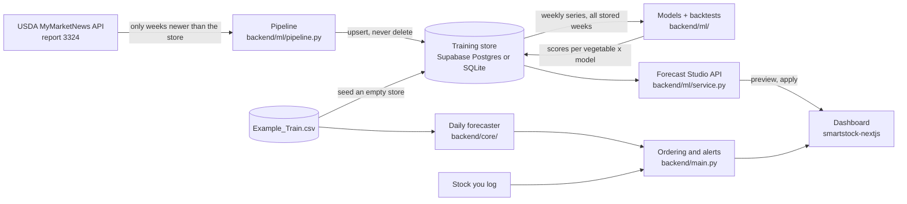

# SmartStock AI

Produce price forecasting and smart ordering for restaurants. SmartStock learns weekly USDA retail prices for eleven vegetables, forecasts where each price is heading, and tells a kitchen how much to order and when, based on what's in the walk-in, how fast it's used, and how long it keeps.

Hosted on **Vercel** (the dashboard from the CDN, the API as one Python function) with the training store in **Supabase**. See [Deploying](#deploying).

[](https://github.com/atanwar8/Smart-Stock-AI/actions/workflows/ci.yml)

## What it does

| Page | What you get |
| --- | --- |
| **Overview** | Price pulse for any vegetable (USDA history, then the forecast with a likely range), days of cover for every tracked item, what needs ordering, each model's forecast skill, and growing weather for any US ZIP code. |
| **Smart ordering** | Log stock and daily use; get a recommended order quantity and cost, plus the cheapest day to buy over the next week. |
| **Forecast studio** | Pick a model (Ensemble, LightGBM, ETS, Theta or seasonal naive), shape a sample prediction with sliders (1–8 weeks ahead, next week by default; confidence; a pace what-if), see how it did on held-out weeks, and **Apply** it. The applied forecast is saved and shown across the app. |
| **Alerts** | Running-out, spoilage and price-move alerts, each explained in one sentence against your own rule, with Silence 24h / Not relevant and J/K keys. |
| **Data refresh** | The Extract → Load → Train → Test pipeline: pulls only the USDA weeks newer than the store, appends them, and rescores every model. Shows the store's coverage and every past run. |

The design is a "chef's market almanac": porcelain canvas, produce drawn as small animated symbols, hand-made SVG charts, keyboard shortcuts (1–5 switch sections, J/K move between produce).

## How it works



- **Training store** (`backend/store/`): four tables, `usda_prices`, `ingest_runs`, `training_runs`, `forecasts` ([ADR-006](docs/decisions/ADR-006-training-store-and-forecast-studio.md)). Supabase Postgres when `SUPABASE_DB_URL` is set, otherwise `backend/var/smartstock.db`. An empty store is seeded once with the last two years of `Example_Train.csv` (6,783 rows, 2023-07-28 to 2025-07-25).
- **Pipeline** (`backend/ml/pipeline.py`, `POST /api/pipeline/refresh`): Extract asks USDA only for the newest stored week (again, for corrections) through today; Load upserts on the natural key, so re-runs add nothing and nothing is deleted; Train and Test backtest every model on all stored weeks with the newest 8 held out, and store the scores. Without a key the run is recorded as skipped and models are still rescored. One refresh at a time across processes (Postgres advisory lock).
- **Forecast Studio** (`backend/ml/service.py`, `backend/routers/forecast.py`): `/forecast/models`, `/forecast/leaderboard`, `/forecast/preview`, `/forecast/apply`, `/forecast/active` (contract in [`docs/handoff/SPEC.md`](docs/handoff/SPEC.md) §5). Models are trained only in the backend: at startup and after every refresh, the pipeline backtests every model on all stored weeks and stores each one's scores and 8-week forecast in `training_runs`. A preview reads that row and rescales it for the sliders, so it never fits a model (about 0.01–0.4 s on Render's free CPU). While training runs (about 3 minutes on Render after a deploy or a refresh), the studio says so and retries on its own.
The overview, Smart ordering and Alerts read the same store and the same trained models (train once, read everywhere):

- **Data agent** (`backend/core/usda_api.py`, driven by `backend/ml/pipeline.py`): only when someone clicks **Data refresh**, asks USDA's MyMarketNews API (report 3324) for the weeks after the newest one in the store, re-requesting that newest week so USDA's corrections replace the old rows, and adds them to Supabase. Nothing is ever deleted, and nothing runs on a schedule or at startup.
- **Forecast agent** (`backend/ml/`): in the same request, backtests and retrains every model on every stored week (about 15 s of training for 6 models on 11 vegetables) and stores each model's scores, calibrated ranges and 8-week forecast. Each vegetable's weekly price is its conventional (non-organic) Midwest price in its usual unit.
- **Ordering and alerts agent** (`backend/main.py`): turns the champion forecast (or the one applied in the studio) into daily prices with its calibrated 80% range, and combines them with the stock you log and each item's shelf life into order recommendations and running-out, spoilage and price-move alerts. No page ever fits a model.

### How good are the forecasts?

Every model is scored on the newest 8 weeks it never saw, and each vegetable's champion is picked on the weeks before them, so the reported score is honest; [`docs/ml/MODEL_GUIDE.md`](docs/ml/MODEL_GUIDE.md) explains each model and the measured results. Short version (data to 23 Oct 2026): ETS, Theta and LightGBM all beat both baselines, with mean MASE about 0.77 against 1.03 for "same as last week" and about +25% skill over "same week last year", and 87% of real prices fell inside the stated 80% ranges. Promotions still cause single-week spikes no model sees coming.

## Run it

| Where | Command | Open |
| --- | --- | --- |
| Cloud | Push to GitHub (Vercel Git integration), see [Deploying](#deploying) | the Vercel project's URL |
| Docker | `docker compose up --build` | http://localhost:8000 |
| Local dev (hot reload) | `./start.sh` | http://localhost:3000 |
| Local, like production | `./start.sh prod` | http://localhost:8000 |

`./start.sh` needs Python 3.9+ (production and CI use 3.11) and Node 20+. The first run installs everything into `backend/.venv` and `smartstock-nextjs/node_modules`. On macOS, LightGBM and XGBoost need `brew install libomp`; without it the backend falls back to scikit-learn models.

In production the dashboard and the API share one origin: the UI calls `/api/...`, and FastAPI answers the same routes with or without the `/api` prefix. In dev, Next.js proxies `/api` to `localhost:8000`. Interactive API docs are at `/docs`.

## Deploying

Vercel project `smartstock-ai` (region `pdx1`, next to the Supabase project in us-west-2), configured by `vercel.json`:

| Part | Where | How |
| --- | --- | --- |
| Dashboard | Vercel CDN | `npm ci && npm run build` in `smartstock-nextjs/`, static files from `smartstock-nextjs/out`. Hashed assets are cached for a year. Nothing to wake up. |
| API | One Python 3.12 function, `api/index.py` | Imports `backend/main.py` unchanged; every `/api/...` request is rewritten to it. Dependencies in `api/requirements.txt`, kept equal to `backend/requirements.txt` by `backend/tests/test_deploy.py`. |
| Training store | Supabase Postgres | `SUPABASE_DB_URL` (session pooler). Prices, model scores, stored forecasts and applied forecasts. |
| Refresh | Only when someone clicks **Data refresh** | `POST /api/pipeline/refresh` runs Extract -> Load -> Train -> Test inside that request: USDA is asked only for the weeks after the newest stored one, the rows are added to Supabase, and every model is retrained and tested. Nothing runs on a schedule or at startup. |

On Vercel (`VERCEL=1`) the backend never trains at startup or in a background thread, because a function is frozen once it answers: every page reads the forecasts the last refresh stored, and **Data refresh** runs the whole pipeline inside its own request. Every push deploys a preview; `main` deploys production. CI (`.github/workflows/ci.yml`) runs the same tests on every push.

First-time setup: Vercel → Add New → Project → import `atanwar8/Smart-Stock-AI` (settings come from `vercel.json`), then add the environment variables below (`SUPABASE_DB_URL`, `MARS_API_KEY`) for Production and Preview, and redeploy. [ADR-007](docs/decisions/ADR-007-vercel-and-supabase.md) explains the move from Render.

## Configuration

Copy `backend/.env.template` to `backend/.env` for local runs, or set these in Vercel → Project → Settings → Environment Variables.

| Variable | Default | What it does |
| --- | --- | --- |
| `MARS_API_KEY` | none | Free USDA MyMarketNews API key ([sign up](https://mymarketnews.ams.usda.gov), then My Profile, API Key). **Data refresh** needs it. |
| `SUPABASE_DB_URL` | none (local SQLite) | Postgres URL of the training store. Use Supabase's **session pooler** string (`postgresql://postgres.<ref>:<password>@aws-1-us-west-2.pooler.supabase.com:5432/postgres`): the direct `db.<ref>.supabase.co` host is IPv6-only and fails from most hosts. |
| `SMARTSTOCK_DB_PATH` | `backend/var/smartstock.db` | SQLite file used when `SUPABASE_DB_URL` is unset. |
| `PIPELINE_ON_STARTUP` | `1` (`0` on Vercel) | At startup: seed an empty store, close runs a crash left open, and score the models once if the store has never been scored (background thread). |
| `PIPELINE_TRAIN_ON_STARTUP` | `1` | Set `0` to skip that first scoring (the leaderboard then computes per vegetable on first view). |
| `TEST_WEEKS` | `8` | Weeks held out for the leaderboard. |
| `SERIES_REGION` | `Midwest` | USDA region the models use (every region is stored). |
| `REFRESH_ON_STARTUP` | `1` | Only without a training store (CSV-only setup): with a key set, pull new USDA weeks into the CSV at startup. With a store, **Data refresh** and the cron are the refresh. Off on Vercel. |
| `SEED_DEMO_INVENTORY` | `1` | Starts with four tracked items so the dashboard isn't empty. Set `0` to start blank. |
| `PRETRAIN_MODELS` | `1` (`0` on Vercel) | Prepares every vegetable's daily forecast at startup (reads the stored champion; trains only where none is stored). |
| `ALLOWED_ORIGINS` | `http://localhost:3000` | Extra CORS origins, only if the UI is hosted separately. |
| `DATA_DIR` | repo root | Folder that holds the CSVs. |
| `PORT` | `8000` | Port the server listens on (Docker, `./start.sh prod`). |

## Tests and quality checks

```bash
cd backend && .venv/bin/pip install -r requirements-dev.txt && .venv/bin/python -m pytest
```

```bash
cd smartstock-nextjs && npm run lint && npx tsc --noEmit && npm run build
```

GitHub Actions (`.github/workflows/ci.yml`) runs all of this on every push and pull request, plus `npm audit` and a Docker build. Dependabot opens one pull request per outdated dependency each week, and CI checks each one.

The backend tests (79) also cover the training store (seed once, upserts that update corrections and never delete, one applied forecast per vegetable), the pipeline (window starts at the newest stored week, re-runs add nothing, missing key and rejected key are recorded, one refresh at a time), the models (no look-ahead, shared LightGBM gives the same answer, conformal bands widen with confidence and horizon) and the studio API (preview shape, sliders, next-week default, Sample prediction → Apply → supersede, previews that read stored forecasts and never fit a model, 503 while training, startup that waits for a busy training lock instead of skipping, contract error codes). Tests always run on a temporary SQLite file, never Supabase. Earlier suites cover the data agent (request format, field mapping, paging, appending without duplicates), the forecast agent (one point per week in one unit, no look-ahead, honest scores on unpredictable prices, forecasts that start from the latest price) and the API (both URL prefixes, predictions, the trend chart, inventory, alert rules, units).

## Project layout

```
smartstock-nextjs/     Dashboard: Next.js static export, Tailwind v4, hand-made SVG charts, lucide icons
  src/components/      One file per page; shell/ (rail, top bar), overview/, ordering/, studio/ (Forecast Studio),
                       charts/ (SVG chart kit), produce/ProduceIcon.tsx (animated produce symbols), ui.tsx (UI kit)
  src/lib/             API clients (api.ts, studio.ts, pipeline.ts), types, navigation, hooks
backend/
  main.py              API routes, inventory, alerts, caching headers, serves the built dashboard
  routers/forecast.py  /forecast/* and /pipeline/* routes
  ml/                  Models, rolling-origin backtests, conformal intervals, studio service, refresh pipeline
  store/               Training store (Supabase Postgres or SQLite), seeding
  core/usda_api.py     Data agent (USDA MyMarketNews API client)
  core/open_meteo.py   Weather by ZIP code from Open-Meteo (no key needed)
  core/                Forecast agent (weekly series, features, training, prediction)
  tests/               pytest suite
Example_Train.csv      Weekly USDA retail prices, 2010 to the latest scrape
docs/decisions/        Architecture decision records
docs/ml/               MODEL_GUIDE.md: the models, the maths, measured results, model card
docs/handoff/          SPEC.md (API + design contract) and each workstream's handoff note
supabase/migrations/   The training store's schema
Dockerfile             Builds the dashboard, then runs API + dashboard in one image
vercel.json            Vercel: static dashboard and the API function
api/                   Vercel Python function (index.py) and its requirements.txt
start.sh               One-command local run
```

## Known limits

- Inventory and alert settings live in the API process's memory. On Vercel each function instance has its own copy, which starts again from the demo inventory after a quiet spell (a cold start), so stock you log may not survive the night. Moving them into Supabase is the next step. USDA prices, model scores and applied forecasts already persist in the training store.
- The first API call after a quiet spell starts a fresh Python instance (a few seconds: importing pandas and reading the price history from Supabase). The dashboard itself loads from the CDN immediately.
- Weather comes from [Open-Meteo](https://open-meteo.com/), free without a key for non-commercial use (under 10,000 calls a day; the app caches each ZIP for 30 minutes). Its data is CC BY 4.0, credited on each weather card. A commercial version of SmartStock would need an Open-Meteo plan ([ADR-005](docs/decisions/ADR-005-open-meteo-weather.md)).
- **Data refresh** needs `MARS_API_KEY`; without it the button is disabled and the page says how to get one. Only one refresh runs at a time.
- Order recommendations count stock in pounds, but some vegetables are priced per head or per bunch, so order cost for those is approximate.
- The dashboard's cost-savings KPI from the original backend is a placeholder and isn't shown.
- `Latest_App_Streamlit.py`, `train_test_updater.py` and `backend/start_backend.py` are from the original Streamlit version and aren't used by the dashboard. The original Selenium scraper was replaced by the USDA API client ([ADR-003](docs/decisions/ADR-003-usda-api-instead-of-browser-scraping.md)).

### Performance

Lighthouse 12.8 on the production build served by the backend (29 Oct 2026): desktop Performance 100, Accessibility 100, Best Practices 100, SEO 100 (LCP 0.7 s, CLS 0.002); mobile (simulated slow 4G) Performance 88, Accessibility 100, Best Practices 100, SEO 100 (LCP 3.3 s, CLS 0.03). The whole app uses one typeface, Urbanist (as before the redesign). Plotly (about 3.5 MB) was removed; the first load is 119 kB of JavaScript. The backend caches expensive answers per data version, sends ETags (304 on unchanged data), gzips JSON, marks hashed assets immutable for a CDN, paginates lists, and pools database connections.

**Train once, read everywhere** (30 Oct 2026). The Overview, Smart ordering and Alerts used to fit their own LightGBM model per vegetable on first use, from the bundled CSV. They now read the same history as the Forecast Studio (the training store, one region) and adopt the pipeline's stored champion forecast, so no web request ever fits a model. Measured on a cold start with the store refreshed to Oct 2026: walk-in list 920 ms -> 40 ms, each further vegetable ~1 s -> 2-5 ms, leaderboard 24 s (on-demand backtest) -> 2 ms. It also fixed a data bug: after USDA's API added every region, the old path averaged all regions together (tomatoes $2.24/lb against the Midwest's $1.65).

## Author

Aryan Tanwar
