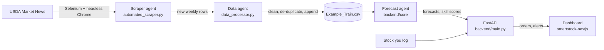

# SmartStock AI

Produce price forecasting and smart ordering for restaurants. SmartStock learns weekly USDA retail prices for ten vegetables, forecasts where each price is heading, and tells a kitchen how much to order and when, based on what's in the walk-in, how fast it's used, and how long it keeps.

[](https://github.com/atanwar8/Smart-Stock-AI/actions/workflows/ci.yml)
[](https://render.com/deploy?repo=https://github.com/atanwar8/Smart-Stock-AI)

## What it does

| Page | What you get |
| --- | --- |
| **Overview** | Price pulse for any vegetable (USDA history, then the forecast with a likely range), days of cover for every tracked item, what needs ordering, each model's forecast skill, and growing weather. |
| **Smart ordering** | Log stock and daily use; get a recommended order quantity and cost, plus the cheapest day to buy over the next week. |
| **Predictions** | 7, 14 or 30-day outlook with low and high cases, a month-by-year seasonality heatmap, and measured price volatility. |
| **Alerts** | Running-out, spoilage and forecast price-move alerts, with editable thresholds and channels. |
| **Data refresh** | Pull the latest USDA reports and retrain every model in one click. |

## How it works

Three agents run the pipeline, and the dashboard sits on top:



- **Scraper agent** (`automated_scraper.py`) opens USDA Market News in Chrome, requests every report newer than the latest date in the training data, and saves them.
- **Data agent** (`data_processor.py`) cleans the export, appends it to `Example_Train.csv`, and drops duplicates, keeping the freshest copy of a re-scraped row.
- **Forecast agent** (`backend/core/forecaster_utils.py`) turns each vegetable's rows into one weekly price series in its usual unit (per lb, each, per bunch...). It trains a LightGBM model on past weeks only, then forecasts week by week from the latest real price. The order recommendations and alerts in `backend/main.py` are built on these forecasts.

### How good are the forecasts?

Each model is scored with time-series cross-validation against a simple rule: "next week costs the same as this week". The dashboard shows the result as **typical error** (in dollars) and **forecast skill** (how much smaller the model's error is than that rule's). Weekly retail prices are noisy, so expect modest skill, not "95% accuracy". [ADR-002](docs/decisions/ADR-002-weekly-series-forecasting.md) explains why the original 95% figure was an artifact.

## Run it

| Where | Command | Open |
| --- | --- | --- |
| Cloud | Click **Deploy to Render** above | the URL Render gives you |
| Docker | `docker compose up --build` | http://localhost:8000 |
| Local dev (hot reload) | `./start.sh` | http://localhost:3000 |
| Local, like production | `./start.sh prod` | http://localhost:8000 |

`./start.sh` needs Python 3.9+ and Node 20+. The first run installs everything into `backend/.venv` and `smartstock-nextjs/node_modules`. On macOS, LightGBM and XGBoost need `brew install libomp`; without it the backend falls back to scikit-learn models.

In production the dashboard and the API share one origin: the UI calls `/api/...`, and FastAPI answers the same routes with or without the `/api` prefix. In dev, Next.js proxies `/api` to `localhost:8000`. Interactive API docs are at `/docs`.

## Deploying

`render.yaml` defines one Docker web service on Render's free plan. After the first deploy, every push to `main` runs CI on GitHub, and Render deploys only if every check passes (`autoDeployTrigger: checksPass`).

[ADR-001](docs/decisions/ADR-001-single-container-on-render.md) explains why this ships as one container on Render.

## Configuration

Copy `backend/.env.template` to `backend/.env` for local runs, or set these in the Render dashboard.

| Variable | Default | What it does |
| --- | --- | --- |
| `OPENWEATHER_API_KEY` | none | Live weather. Without it the app uses sample weather data. |
| `SEED_DEMO_INVENTORY` | `1` | Starts with four tracked items so the dashboard isn't empty. Set `0` to start blank. |
| `PRETRAIN_MODELS` | `1` | Trains every vegetable's model in the background at startup. |
| `ALLOWED_ORIGINS` | `http://localhost:3000` | Extra CORS origins, only if the UI is hosted separately. |
| `DATA_DIR` | repo root | Folder that holds the CSVs. |
| `PORT` | `8000` | Port the server listens on (Render sets this). |

## Tests and quality checks

```bash
cd backend && .venv/bin/pip install -r requirements-dev.txt && .venv/bin/python -m pytest
```

```bash
cd smartstock-nextjs && npm run lint && npx tsc --noEmit && npm run build
```

GitHub Actions (`.github/workflows/ci.yml`) runs all of this on every push and pull request, plus `npm audit` and a Docker build. Dependabot opens one pull request per outdated dependency each week, and CI checks each one.

The backend tests cover the forecast agent (one point per week in one unit, no look-ahead, honest scores on unpredictable prices, forecasts that start from the latest price) and the API (both URL prefixes, predictions, the trend chart, inventory, alert rules, units).

## Project layout

```
smartstock-nextjs/     Dashboard: Next.js static export, Tailwind, Plotly charts, lucide icons
  src/components/      One file per page plus the shared UI kit (ui.tsx) and chart theme (Chart.tsx)
  src/lib/             API client, types, navigation, backend health hook
backend/
  main.py              API routes, inventory, alerts, serves the built dashboard
  core/                Forecast agent (weekly series, features, training, prediction, weather)
  tests/               pytest suite
automated_scraper.py   Scraper agent
data_processor.py      Data agent
Example_Train.csv      Weekly USDA retail prices, 2010 to the latest scrape
docs/decisions/        Architecture decision records
Dockerfile             Builds the dashboard, then runs API + dashboard in one image
render.yaml            Render blueprint
start.sh               One-command local run
```

## Known limits

- Inventory, alert settings and trained models live in memory, so they reset on restart or redeploy.
- The free Render plan sleeps after 15 idle minutes and takes about a minute to wake.
- **Data refresh** starts Chromium, which needs more than the free plan's 512 MB. Use a bigger instance or run the scraper locally. Only one refresh runs at a time.
- Order recommendations count stock in pounds, but some vegetables are priced per head or per bunch, so order cost for those is approximate.
- The dashboard's cost-savings KPI from the original backend is a placeholder and isn't shown.
- `Latest_App_Streamlit.py`, `train_test_updater.py` and `backend/start_backend.py` are from the original Streamlit version and aren't used by the dashboard.

## Author

Aryan Tanwar
